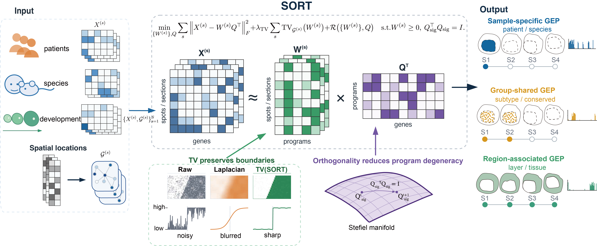

# SORT

[](LICENSE)
[](pyproject.toml)

SORT (Spatial Orthogonal Regularized Transcriptomic decomposition) is a method
for discovering gene-expression programs (GEPs) in spatial transcriptomic
atlases. It jointly decomposes normalized expression from multiple sections
into shared transcriptomic profiles and section-specific nonnegative spatial
activity maps, without requiring prior spatial alignment across sections.

Orthogonality separates the transcriptomic profiles into distinct directions,
while graph total variation promotes spatially coherent activity within tissue
regions and preserves sharp boundaries. This allows SORT to recover programs
that may be specific to one sample, shared within a biological group or active
in particular tissue regions.



## Features

- joint analysis of multiple spatial transcriptomic sections or samples;
- shared gene-expression profiles with sample-specific spatial activities;
- recovery of spatial programs at different biological scales;
- CPU and CUDA support;
- integration with `AnnData` and Scanpy workflows.

## Installation

SORT uses one package for CPU and GPU execution. CUDA is optional, not an
installation requirement. At runtime, `device="auto"` uses CUDA only when
both PyTorch and CuPy can access a GPU; otherwise it selects CPU.

### 1. Create an environment

Start with a recent Conda or Miniforge installation. The environment supplies
Python 3.8.20, NumPy, SciPy and OpenBLAS.

```bash
git clone https://github.com/zerovain/SORT.git
cd SORT
conda env create --solver libmamba -f environment.yml
```

The default environment is tested on Linux x86_64. On Apple-silicon Macs,
replace `environment.yml` with `environment-macos.yml` in the command above.

Activate the environment:

```bash
conda activate sort
export PYTHONNOUSERSITE=1
```

**Apple silicon only:** build `scikit-misc` 0.2.0 before installing SORT.
This version has no Python 3.8 ARM64 wheel. With Apple's Command Line Tools
and Homebrew installed:

```bash
brew install gcc pkgconf
export CC=/usr/bin/clang CXX=/usr/bin/clang++ FC=gfortran
export SDKROOT="$(xcrun --show-sdk-path)"
export PKG_CONFIG_PATH="$CONDA_PREFIX/lib/pkgconfig${PKG_CONFIG_PATH:+:$PKG_CONFIG_PATH}"
python -m pip install --no-cache-dir --no-deps --no-binary=scikit-misc scikit-misc==0.2.0
```

Then continue with the installation steps below.

### 2. Optional: enable GPU acceleration

Skip this step for CPU execution. If you have an NVIDIA GPU, install
CUDA-enabled PyTorch and CuPy before
installing SORT. For a CUDA 12.1-compatible driver, the tested combination is:

```bash
python -m pip install torch==2.4.1 --index-url https://download.pytorch.org/whl/cu121 -c constraints-reference.txt
python -m pip install cupy-cuda12x==12.3.0 -c constraints-reference.txt
```

See the [official installation guide](https://pytorch.org/get-started/locally/)
for platform and driver requirements. Keep PyTorch 2.4.1 for this environment.
The commands above install the Python GPU runtimes; an NVIDIA driver must
already be installed.

### 3. Install SORT

Use the same command with or without GPU acceleration:

```bash
python -m pip install -e '.[tutorial]' -c constraints-reference.txt
python -m pip check
```

Conda supplies Python, NumPy, SciPy and OpenBLAS.
Create the Conda environment before installing SORT with pip to retain these
numerical packages. The constraints fix the remaining scientific dependencies,
including Scanpy 1.9.8, Squidpy 1.2.3 and `scikit-misc` 0.2.0.
CuPy is optional and is installed only in the GPU
step above or through the `gpu` extra.

At runtime, let SORT choose the available device:

```python
result = sort.fit(adata, n_components=25, device="auto")
```

Use `device="cuda"` to require GPU execution or `device="numpy"` to select CPU.

### Installation notes

If Conda reports that the libmamba solver is unavailable, update Conda or use
a recent Miniforge installation. No global channel changes are needed.

To run the package tests, install the `test` extra and run:

```bash
python -m pip install -e '.[test]' -c constraints-reference.txt
python -m pytest tests -q
```

The simulation example runs on a standard desktop CPU; no GPU or other
non-standard hardware is required. The optional GPU route uses
PyTorch 2.4.1+cu121 and CuPy 12.3.0. Allow additional download time for the CUDA
libraries. CPU and GPU fits can differ numerically.

The complete simulation notebook, including PCA/NMF, plotting and matrix export,
was tested on CPU. SORT fitting took about 45–80 seconds in the tested
configurations. Runtime depends on hardware and numerical thread settings;
installation time depends on download speed and whether packages are cached.

## Basic usage

For a single spatial section:

```python
import scanpy as sc
import sort

adata = sc.read_h5ad("prepared_spatial_data.h5ad")

# Seurat-v3 feature selection expects counts, before normalization/logging.
sc.pp.highly_variable_genes(adata, n_top_genes=3000, flavor="seurat_v3")
sc.pp.normalize_total(adata, target_sum=1e4)
sc.pp.log1p(adata)
adata = adata[:, adata.var["highly_variable"]].copy()

sort.build_spatial_graph(adata, n_neighbors=8)
sort.compute_laplacian(adata)

result = sort.fit(adata, n_components=25)

print(result.W.shape)  # spatial locations × components
print(result.Q.shape)  # genes × components
```

For multiple samples stored in one `AnnData` object, SORT can construct a
separate spatial graph for each sample:

```python
sort.build_per_sample_graph(
    adata,
    n_neighbors=8,
    sample_key="sample_id",
)
```

## Output

- `result.W` contains the nonnegative spatial activity of each component at
  each spatial location;
- `result.Q` contains the corresponding gene weights shared across samples.

`Q` and `gene_names` retain the input gene order. When only marked highly
variable genes are fitted, unused rows of `Q` are zero and are identified by
`result.metadata['fitted_gene_mask']`; these zeros do not estimate expression
for unused genes. Full dense reconstruction is not allocated by default.

```python
result.save("outputs/my_atlas")  # W, Q, gene/location names and metadata
small_reconstruction = result.reconstruct(rows=[0, 1], genes=[0, 1])
```

Set `store_reconstruction=True` during fitting to explicitly store the full
input-gene reconstruction in `adata.layers['sort_reconstructed']`. This may
require substantial memory for an atlas. `verbose=False` silences progress;
the default shows the device and initialization/stage progress without
optimizer-debug diagnostics.

The requested `n_components` includes one background component. The first
component (Python index `0`, reported as GEP00 in the manuscript) captures the
broad background expression fitted by the model. The remaining components are
the signal GEPs used for biological interpretation. For example,
`n_components=25` returns one background component and 24 signal GEPs.

## Tutorials and documentation

Detailed tutorials are available in the
[SORT_tutorial repository](https://github.com/zerovain/SORT_tutorial):

[Online documentation](https://sort-tutorial.readthedocs.io/)

- [Simulated spatial atlas](https://github.com/zerovain/SORT_tutorial/blob/main/notebooks/00_simulated_atlas.ipynb)
- [PDAC atlas](https://github.com/zerovain/SORT_tutorial/blob/main/notebooks/01_pdac_atlas.ipynb)
- [Mouse embryogenesis atlas](https://github.com/zerovain/SORT_tutorial/blob/main/notebooks/02_embryogenesis.ipynb)

## Citation

Citation information will be provided upon publication of the associated
manuscript.

## License

SORT is released under the [MIT License](LICENSE).

## Support

Please report bugs and usage questions through the
[GitHub issue tracker](https://github.com/zerovain/SORT/issues).
